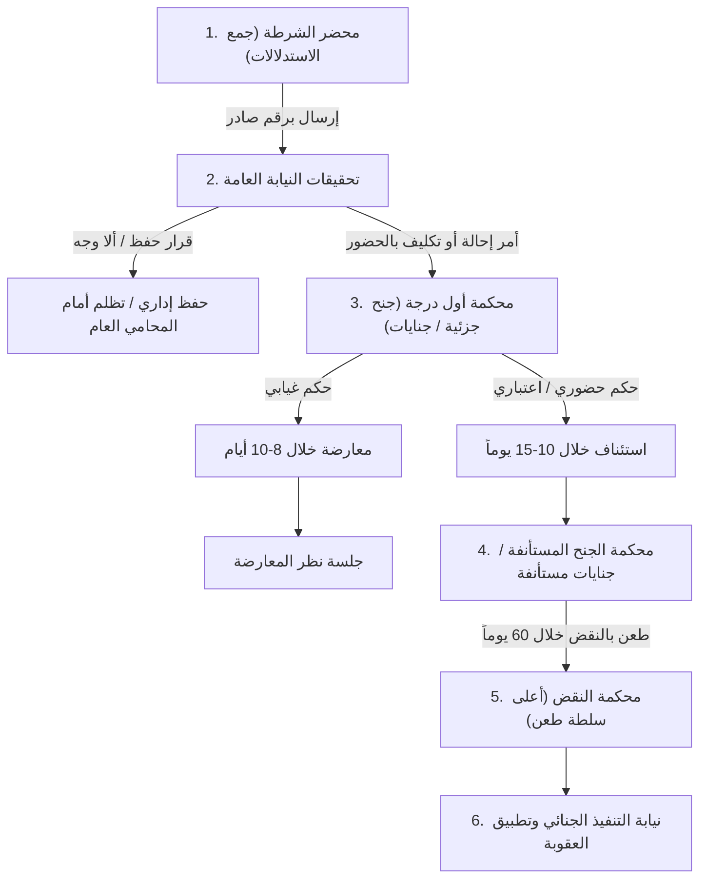
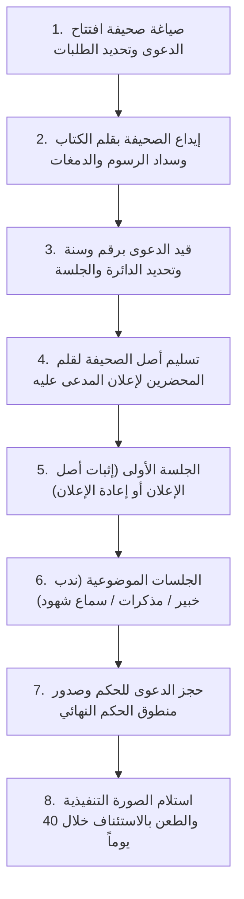
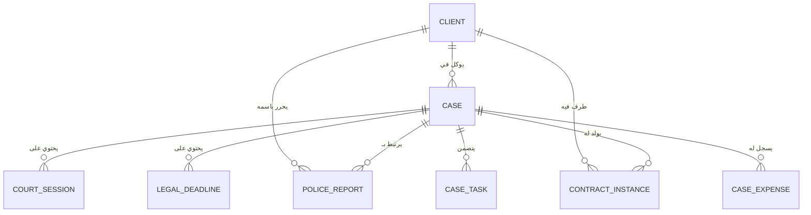

# الدليل الشامل لدورة حياة القضايا والمحاضر في القانون المصري
## Comprehensive Egyptian Legal Case Workflows & Court Procedures Data Model

مستند مرجعي شامل يوثق دورات حياة كافة أنواع القضايا والمحاضر والطعون في النظام القضائي المصري، وفقاً لقوانين الإجراءات الجنائية، المرافعات المدنية والتجارية، محاكم الأسرة، المحاكم الاقتصادية، وقانون مجلس الدولة، وقواعد التنفيذ الجبري.

---

## الفهرس العام
1. [دورة حياة القضايا الجنائية (من محضر الشرطة إلى النقض والتنفيذ)](#1-دورة-حياة-القضايا-الجنائية)
2. [دورة حياة القضايا المدنية والتجارية (من افتتاح الصحيفة إلى الحكم البات)](#2-دورة-حياة-القضايا-المدنية-والتجارية)
3. [دورة قضايا الأحوال الشخصية ومحاكم الأسرة](#3-دورة-قضايا-محاكم-الأسرة)
4. [دورة قضايا المحاكم الاقتصادية والتحكيم](#4-دورة-قضايا-المحاكم-الاقتصادية)
5. [دورة قضايا القضاء الإداري ومجلس الدولة](#5-دورة-قضايا-مجلس-الدولة)
6. [منظومة التنفيذ الجبري وإشكالات التنفيذ والحجوزات](#6-منظومة-التنفيذ-الجبري)
7. [الجدول القياسي للمدد القانونية ومواعيد السقوط الإجرائية](#7-جدول-المدد-القانونية-ومواعيد-السقوط)
8. [ربط نموذج البيانات البرمجي داخل نظام Siyaq / Baseera Legal OS](#8-ربط-نموذج-البيانات-البرمجي)

---

## 1. دورة حياة القضايا الجنائية
تبدأ القضية الجنائية بواقعة جنائية وتمر بـ 5 مراحل متتابعة:

### المرحلة الأولى: جمع الاستدلالات (محضر قسم الشرطة)
* **جهة الاختصاص:** مأمورو الضبط القضائي (أقسام ومراكز الشرطة، نقاط الشرطة، الإدارات النوعية كالتهرب الضريبي أو مباحث الأموال العامة ومباحث الإنترنت).
* **إجراءات تحرير المحضر:**
  1. توجه الشاكي/المجني عليه أو وكيله القانوني (بتوكيل خاص أو عام قضايا) إلى "نوبتجية القسم".
  2. إثبات الرقم القومي للأطراف ومحل إقامتهم وصفاتهم.
  3. تدوين أقوال الشاكي، حصر المسروقات/التلفيات/المبالغ محل التبديد أو النزاع، وتقديم المستندات وحوافظ الأوراق (مثل أصل إيصال الأمانة، صور الشيكات، التقرير الطبي، أو تقرير الفحص الفني للرسائل).
  4. إجراء معاينة أولية أو تكليف وحدة المباحث بإجراء التحريات السرية حول صحة الواقعة.
  5. قيد المحضر بسجل الأحوال ثم إعطاؤه رقماً رسمياً: (رقم جنحة، رقم جنحة مرور، أو رقم إداري).
  6. تصدير المحضر إلى النيابة العامة المختصة برقم صادر وتاريخ إرسال.

### المرحلة الثانية: التحقيق الابتدائي والتصرف (النيابة العامة)
* **قيد الأوراق:** يرد المحضر إلى النيابة الجزئية ويقيد برقم وارد نيابة، ثم يُعرض على وكيل النائب العام المختص.
* **إجراءات الاستيفاء:**
  * استدعاء الشاكي لسماع أقواله تفصيلاً وسؤاله عن طلباته ومستنداته.
  * استدعاء المشكو في حقه ومواجهته بالتهمة والأدلة.
  * ندب الخبراء الفنيين: الطب الشرعي، مصلحة التزييف والتزوير، أو خبراء الأدلة الرقمية.
  * في الجنايات والجنح الهامة: إصدار أوامر الضبط والإحضار، وقرار الحبس الاحتياطي، والعرض على قاضي المعارضات لتجديد الحبس.
* **قرارات التصرف في النيابة العامة:**
  1. **الحفظ الإداري (إداري):** إذا تبين كيدية البلاغ أو خلوه من الجريمة أو عدم كفاية الأدلة (يحق للشاكي التظلم منه أمام المحامي العام للنيابة الكلية).
  2. **أمر بألا وجه لإقامة الدعوى الجنائية:** قرار قضائي ينهي التحقيق لسبب قانوني أو موضوعي.
  3. **الإحالة إلى المحاكمة الجنائية:**
     * **في الجنح:** تحرير قائمة التكليف بالحضور وإرسال الأوراق إلى محكمة الجنح الجزئية لتحديد جلسة لنظرها.
     * **في الجنايات:** إعداد قائمة بأدلة الثبوت وملاحظات النيابة، وإصدار "أمر إحالة" معتمد من المحامي العام إلى محكمة الجنايات المختصة.

### المرحلة الثالثة: المحاكمة أمام محكمة أول درجة
* **إعلان المتهم:** يتم إعلان المتهم قانوناً بورقة التكليف بالحضور، وتحديد موعد الجلسة والدائرة القضائية.
* **رول الجلسات:**
  * الجلسة الأولى: المناداة على الخصوم، إثبات حضور المحامي بالتوكيل، تقديم طلبات الدفاع وحوافظ المستندات، ومذكرات الدفوع.
  * التأجيل: لتقديم أصل المستندات، استدعاء الشهود، أو ورود التقارير الفنية.
  * المرافعة الختامية وحجز الدعوى للحكم.
* **منطوق الحكم:**
  * البراءة ورفض الدعوى المدنية.
  * الإدانة (حبس، غرامة، كفالة لوقف التنفيذ المؤقت، ومصاريف الدعوى الجنائية، والتعويض المدني المؤقت).

### المرحلة الرابعة: طرق الطعن في الأحكام الجنائية
1. **المعارضة الجنائية (في الأحكام الغيابية):**
   * الميعاد القانوني: **10 أيام** من تاريخ إعلان المحكوم عليه بالحكم الغيابي أو العلم اليقيني به.
   * الأثر: توقف تنفيذ العقوبة فوراً وتحدد جلسة جديدة لنظر الدعوى من جديد أمام نفس الدائرة.
2. **الاستئناف الجنائي:**
   * الميعاد القانوني: **10 أيام** من تاريخ صدور الحكم الحضوري أو الحكم في المعارضة (والمحامي العام له الحق في الاستئناف خلال 30 يوماً).
   * المحكمة: محكمة الجنح المستأنفة أو محاكم الجنايات الاستئنافية (تعديلات 2024).
3. **الطعن بالنقض الجنائي:**
   * الميعاد القانوني: **60 يوماً** كاملة من تاريخ صدور الحكم الاستئنافي النهائي.
   * الإجراء: إيداع مذكرة بأسباب الطعن موقعة من محامٍ مقبول للمرافعة أمام محكمة النقض وسداد الكفالة المقررة.

---

## 2. دورة حياة القضايا المدنية والتجارية

### بيانات صحيفة الدعوى الإلزامية (المادة 63 مرافعات):
1. اسم المدعي ولقبه ومهنته وموطنه وموطنه المختار الذي يوجه إليه الإعلانات.
2. اسم المدعى عليه ولقبه ومهنته وموطنه.
3. تاريخ تقديم الصحيفة إلى قلم الكتاب.
4. المحكمة المرفوعة أمامها الدعوى والدائرة القضائية.
5. وقائع الدعوى والطلبات الختامية وأسانيدها من الواقع والقانون.

### إدارة رول الجلسات المدنية:
* **إعادة الإعلان:** إذا لم يثبت إعلان المدعى عليه لشخصه في الجلسة الأولى، تقرر المحكمة تأجيل الدعوى لإعادة إعلانه مع شمول القرار بالتحري إن لزم الأمر.
* **مكتب الخبراء:** عند انتداب خبير وزارة العدل:
  * سداد أمانة الخبير المقررة خلال الميعاد المحدد بالقرار.
  * إرسال ملف الدعوى إلى مكتب خبراء وزارة العدل المختص.
  * حضور جلسات الفحص أمام الخبير وتقديم المستندات والرد على تقرير الخصم.
  * إيداع تقرير الخبير بقلم كتاب المحكمة وإخطار الخصوم، ثم إعادة الدعوى للمرافعة.
* **حجز الدعوى للحكم:** تقفل المحكمة باب المرافعة وتحدد موعداً للنطق بالحكم، مع التصريح بتقديم مذكرات ختامية ومستندات في آجال محددة.

---

## 3. دورة قضايا محاكم الأسرة
* **تسوية المنازعات الأسرية:** وجوب التقدم بطلب تسوية أمام "مكتب تسوية المنازعات الأسرية" بالمحكمة قبل قيد الدعوى القضائية.
* **مهلة التسوية:** مدة 15 يوماً للتوفيق بين الزوجين/الطرفين، وعند التعذر تحال الدعوى للمحكمة بقيد رسمي.
* **أنواع الدعاوى:**
  * النفقات والأجور (نفقة زوجية، نفقة صغار، أجر مسكن، أجر حضانة، مصاريف علاج ودراسة).
  * دعاوى الطلاق والخلع والفسخ.
  * دعاوى الرؤية والحضانة والضم.
  * دعاوى الحبس للامتناع عن سداد متجمد النفقات (حبس 30 يوماً).

---

## 4. دورة قضايا المحاكم الاقتصادية
* أنشئت بالقانون رقم 120 لسنة 2008 وتختص بمنازعات التجارة الدولية والاستثمار والشركات وعمليات البنوك وحماية المستهلك وسوق المال والتوقيع الإلكتروني.
* **هيئة التحضير والوساطة:** مرحلة إلزامية تقوم بها هيئة متخصصة للوساطة والتسوية الودية بين الشركات قبل إحالة النزاع إلى الدوائر القضائية.
* **الدوائر:**
  * دوائر ابتدائية: تختص بالدعاوى التي لا تتجاوز قيمتها 10 ملايين جنيه، واستئنافها أمام الدوائر الاستئنافية.
  * دوائر استئنافية: تنظر الدعاوى الاستئنافية والدعاوى الكبرى التي تزيد على 10 ملايين جنيه مباشرة، ويكون الطعن على أحكامها أمام محكمة النقض مباشرة.

---

## 5. دورة قضايا مجلس الدولة (القضاء الإداري)
* تختص بالفصل في الطعون الإدارية والقرارات الصادرة من الجهات الإدارية والحكومية، ومنازعات العقود الإدارية، ودعاوى التعويض ومسابقات التعيين.
* **هيئة مفوضي الدولة:** بعد قيد الطعن، يُحال ملف الدعوى وجوباً إلى هيئة مفوضي الدولة لإعداد تقرير بالرأي القانوني المسبب قبل نظر الدعوى أمام المحكمة.
* **المحكمة الإدارية العليا:** هي الجهة القضائية العليا للطعن على أحكام محاكم القضاء الإداري خلال ميعاد 60 يوماً.

---

## 6. منظومة التنفيذ الجبري
1. **الصيغة التنفيذية:** ختم رسمي على الحكم القضائي الحائز لحجية الأمر المقضي أو المشمول بالنفاذ المعجل بنص:
   > «على وزراء الدولة ورجالها أن ينفذوا هذا الحكم متى طُلب منهم ذلك ولو باستعمال القوة الجبرية...»
2. **إعلان السند التنفيذي (مادة 281 مرافعات):** وجوب إعلان المدين بصورة الحكم التنفيذية وتكليفه بالوفاء مع إمهاله مدة يوم عمل على الأقل قبل البدء في التنفيذ.
3. **حجز ما للمدين لدى الغير:** استصدار أمر حجز تحت يد البنوك أو الشركات المدينة للمدين، وإلزام البنك بتقرير ما في ذمته وتجنيب المبلغ للدائن.
4. **الحجز التنفيذي على المنقولات والعقارات:** انتقال معاون التنفيذ لجرد المنقولات وتحديد يوم للبيع بالمزاد العلني.
5. **إشكالات التنفيذ:** منازعة وقتية يرفعها المدين أو الغير أمام قاضي التنفيذ لوقف إجراءات التنفيذ لحين الفصل في صحة السند أو انقضاء الالتزام.

---

## 7. جدول المدد القانونية ومواعيد السقوط

| نوع الإجراء / الطعن | الميعاد القانوني | السند القانوني | أثر انقضاء الميعاد |
| :--- | :--- | :--- | :--- |
| **معارضة جنح (غيابي)** | 10 أيام من تاريخ الإعلان | م 398 إجراءات جنائية | سقوط الحق في المعارضة وصيرورة الحكم قابلاً للاستئناف |
| **استئناف جنح** | 10 أيام من تاريخ الحكم الحضوري | م 406 إجراءات جنائية | سقوط حق الطعن وصيرورة الحكم نهائياً وواجب النفاذ |
| **استئناف أحكام مدنية وتجارية** | 40 يوماً من صدور الحكم | م 227 مرافعات | صيرورة الحكم الابتدائي نهائياً وحائزاً لقوة الأمر المقضي |
| **استئناف أحكام القضاء المستعجل** | 15 يوماً | م 227 مرافعات | سقوط حق الاستئناف |
| **طعن بالنقض (مدني / تجاري / أسرة)** | 60 يوماً من الحكم الاستئنافي | م 252 مرافعات | صيرورة الحكم باتاً غير قابل للطعن بأي طريق عادي |
| **طعن بالنقض (جنائي)** | 60 يوماً من صدور الحكم النهائي | م 34 ق حالات وإجراءات الطعن بالنقض | سقوط الحق وإيداع المحكوم عليه لتنفيذ العقوبة |
| **طعن أمام المحكمة الإدارية العليا** | 60 يوماً من صدور حكم القضاء الإداري | م 44 ق مجلس الدولة 47 لسنة 1972 | صيرورة الحكم الإداري نهائياً وباتاً |
| **تظلم من أمر على عريضة / أمر أداء** | 10 أيام من تاريخ الإعلان بالأمر | م 206 مرافعات | سقوط حق التظلم واعتبار الأمر في قوة السند التنفيذي |
| **إيداع مذكرة دفاع ختامية** | حسب أجل المحكمة (3 - 7 أيام) | قرار الدائرة في محضر الجلسة | استبعاد المذكرة والحكم في الدعوى بحالتها |
| **سداد أمانة الخبير القضائي** | خلال الأجل المحدد بقرار الجلسة | م 137 إثبات | سقوط حق الخصم في التمسك بحكم ندب الخبير |

---

## 8. ربط نموذج البيانات البرمجي داخل النظام

لتجسيد هذا النظام في كود التطبيق، ترتبط الجداول والكائنات كما يلي:

* **التزامن الفوري (Realtime Reactivity):** أي ميعاد قانوني أو جلسة أو محضر يُضاف في أي صفحة يتم إرساله فوراً إلى `appStore`، وتحديث الـ `LocalStorage`، وبثه لجميع المكونات المشتركة (`Header`, `CalendarPage`, `DeadlinesPage`, `DashboardPage`).
* **توليد العقود التلقائي (Auto Contract Hydration):** عند اختيار "إنشاء عقد لهذه القضية"، يتم سحب بيانات الموكل، الخصم، رقم الدعوى، المحكمة، المحامي، والأتعاب، وتعبئتها مباشرة في محرك القوالب القانونية ليطبع العقد أو يعدل عليه المحامي بنقرة واحدة.
